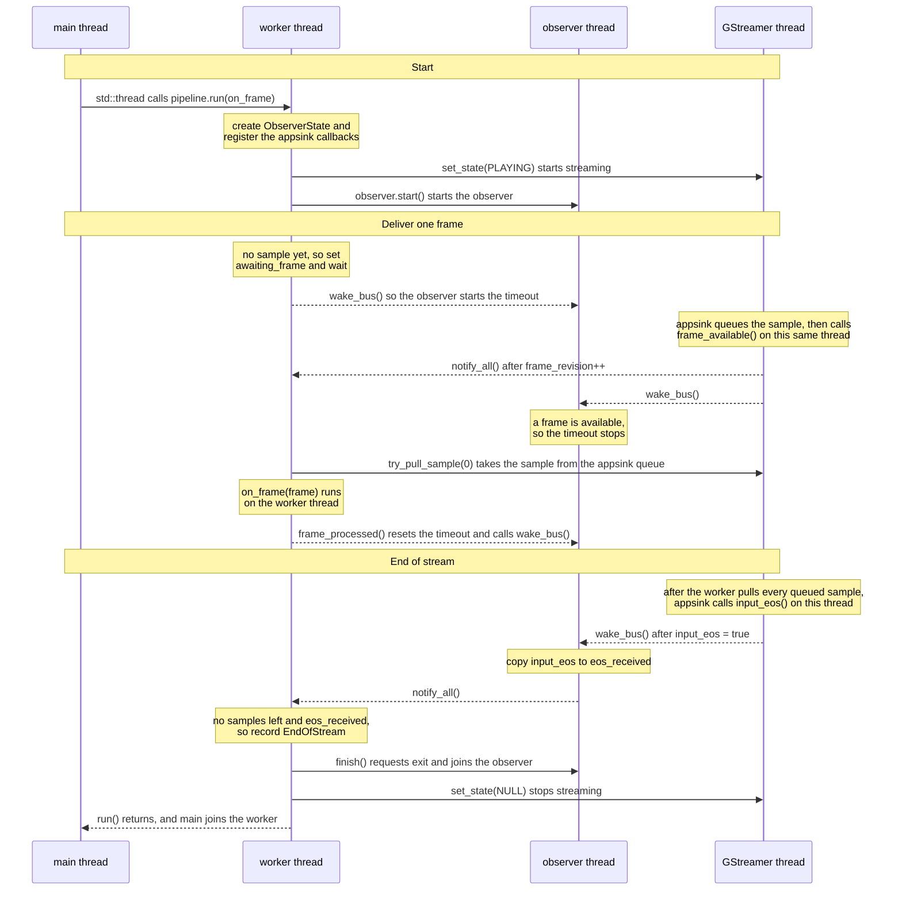
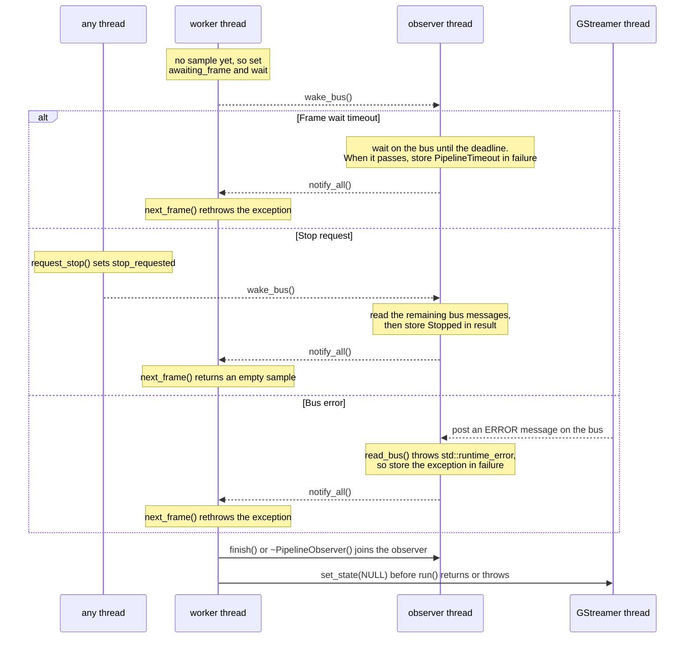

# Streambrew

Video processing experiments

## Build and run

Install the GStreamer development package, `pkg-config`, CMake, and a C++ compiler. From the project root, run:

```sh
cmake -S . -B build
cmake --build build
./build/main sample.mp4
```

Pass another file path to play a different video. VS Code reads the include paths from CMake's `build/compile_commands.json`.

## Development commands

```sh
make build                   # Configure and build
make run SOURCE=sample.mp4   # Build and process a video
make test                    # Build and run tests
make format                  # Apply formatting to C++ sources and headers
make format-check            # Check formatting without changing files
make lint                    # Run static analysis; warnings cause failure
make check                   # Run format-check, lint, and tests
make clean                   # Remove build outputs, keeping CMake configuration
```

Override the build directory, build type, or parallelism as needed

```sh
make test BUILD_DIR=build-debug BUILD_TYPE=Debug JOBS=4
```

Tool paths can also be overridden, for example `make lint CLANG_TIDY=clang-tidy-18`.

## Frame delivery API

```cpp
#include "pipeline/frame_pipeline.h"

streambrew::PipelineOptions options;
options.timing = streambrew::DeliveryTiming::AsFastAsPossible;
options.overflow = streambrew::OverflowPolicy::BlockProducer;
options.max_pending_frames = 4;

streambrew::FramePipeline pipeline("sample.mp4", streambrew::PixelFormat::RGB, options);
pipeline.run([](const streambrew::Frame &frame) {
    // Process frame.data here, using frame.stride to advance between rows.
});
```

| Option | Behavior |
| --- | --- |
| `AsFastAsPossible` | Processes delivered frames as fast as possible. Disables audio playback. Live sources (e.g. RTSP) still produce frames at their own rate |
| `Clocked` (default) | Wait for video timestamps on the pipeline clock |
| `BlockProducer` (default) | Wait for queue space and preserve queued frames in order |
| `DropOldest` | Discard the oldest pending frame when the queue is full. Only preserve newer frames |

`max_pending_frames` defaults to **1** and must be in `[1, G_MAXUINT]`.
It limits the appsink queue, excluding the frame in the callback and upstream buffers.

## Threading model

A run uses four threads.

| Thread | Role |
| --- | --- |
| main | Creates the `FramePipeline` and calls `run()` on a worker thread (`src/main.cpp`). |
| worker | The thread that calls `run()`. It pulls samples from the appsink, calls the frame callback, and decides `EndOfStream`. |
| observer | Started by `run()`. It reads bus messages and handles stop requests, errors, and timeouts. |
| GStreamer | Created by GStreamer. It decodes the video and calls the appsink callbacks (`new_sample` and `eos`). |

The threads share their state through `ObserverState`, and a mutex protects that state.
`ObserverState` is not a thread. It only records what happened, for example that a new frame arrived or that the run must stop.
The worker waits on a condition variable.
The observer waits on the GStreamer bus.
To wake the observer, another thread posts an empty application message to the bus with `wake_bus()`.
Because of this, the observer does not check its state at a fixed interval.

Frame data does not go through `ObserverState` or the observer.
The appsink keeps each decoded sample in its own queue, and the worker pulls the sample from that queue.

In the diagrams below, a solid arrow means that one thread calls or starts another.
A dashed arrow means that one thread wakes another.
A note shows work that a thread does by itself.

### Normal run



The appsink calls the `eos` callback only after the worker has pulled every queued sample.
So the worker does not lose the last frames when it reports `EndOfStream`.

### Early exit

A run can end early in three ways.
In each case, the observer stores the result in `ObserverState`, and the worker reads it in `next_frame()`.



- If `timeout_action` is `TimeoutAction::WarnAndContinue`, the observer calls `warning_handler` once instead of storing an exception. The run continues.
- A stop request does not interrupt a callback that is running. The worker sees the request after the callback returns.
- If an ERROR message is still on the bus when a stop is requested, `run()` throws that error instead of returning `Stopped`.

## Tests

The integration test generates its own AVI fixtures, including one with audio.
It requires the GStreamer Base and Good runtime plugins (`videotestsrc`, `audiotestsrc`, `avimux`, and `avidemux`).

Lifecycle tests use an in-process `appsrc` to check silent/stalled inputs, stop requests, timeout stages, exception cleanup, and concurrent/repeated runs.

```sh
cmake -S . -B build
cmake --build build
ctest --test-dir build --output-on-failure
```
